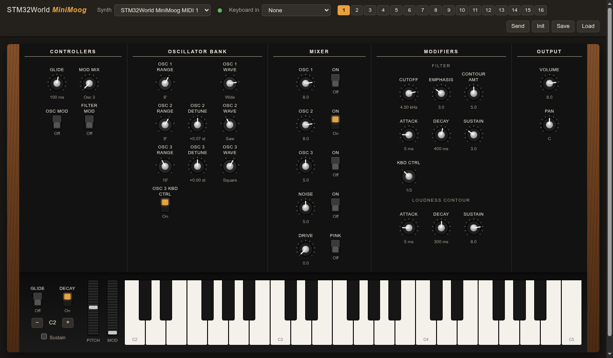
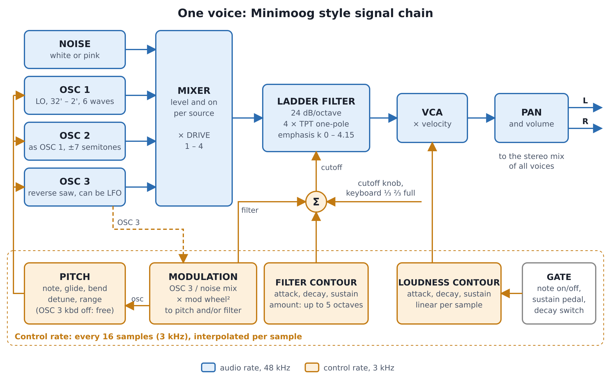

# cmsynth

CurrentMakers Polyphonic MIDI Synthesizer: a polyphonic, multitimbral USB
MIDI synthesizer for microcontrollers, inspired by the Minimoog Model D.

Wiki: https://stm32world.com/wiki/Polyphonic_MIDI_Synthesizer

- Per voice, as on the Minimoog: three oscillators (PolyBLEP triangle,
  tri-saw, saw, square and two pulse widths, ranges LO and 32' to 2'), white
  or pink noise, a mixer with drive, a 24 dB ladder filter that self-oscillates
  with keyboard tracking, filter and loudness contours (attack, decay,
  sustain and the decay switch), glide, and oscillator 3 or noise as
  modulation on the mod wheel.
- 16 MIDI channels, each with its own complete patch, sharing the voices
  (8 on the STM32F407, 32 on the RP2354 with both cores at 320 MHz, 32 on
  the STM32H723 at 550 MHz).
- Every panel control is a MIDI CC, with 14 bit resolution for cutoff and
  detune.
- A web panel and keyboard that talks to the synth with Web MIDI.

## Repository layout

- `src/` - the synth engine (`synth.c`), the MIDI CC map (`params.c`) and the
  MIDI handling (`midi.c`). Portable C, no MCU specific code.
- `examples/` - one firmware project per target board:
  - [`sl_mcu_stm32f407`](examples/sl_mcu_stm32f407) - STM32F407 with the
    PCM5102 audio DAC Streamline blade, STM32CubeIDE project
  - [`sl_mcu_rp2354`](examples/sl_mcu_rp2354) - RP2354 (Arm Cortex-M33) with
    the same audio blade, Pico SDK project for VS Code
  - [`sl_mcu_stm32h723`](examples/sl_mcu_stm32h723) - STM32H723 (Arm
    Cortex-M7 at 550 MHz) with the same audio blade, STM32CubeIDE project
- `lib/tinyusb` - TinyUSB (git submodule) for USB MIDI on the STM32 (the RP2354
  uses the Pico SDK's)
- `midi/` - demo MIDI files that set up their own patches, see
  [midi/README.md](midi/README.md)
- `samples/` - recordings of the demos from the line out
- `web/` - HTML5 panel and keyboard
- `docs/diagrams/` - block diagrams (SVG and PNG), generated by
  `make_diagrams.py`
- `tools/` - scripts for the demos, recordings and MIDI files (below)

More targets can be added as further examples using the same `src/`.

### Performance

The same worst case on every target: every voice playing the most expensive
patch (three oscillators and noise, all filter and contour stages busy),
measured with the cycle counter around every audio block of 1.33 ms:

| Target | Core | Clock | Voices | CPU per block | Per voice |
|--------|------|-------|--------|---------------|-----------|
| STM32F407 | Cortex-M4 | 168 MHz | 8 | about 75% | about 125 us |
| STM32H723 | Cortex-M7 | 550 MHz | 32 | 86% (one core) | about 36 us |
| RP2354 | 2 x Cortex-M33 | 150 MHz (rated) | 16 | 76.7% (both cores) | about 64 us (128 us per core) |
| RP2354 | 2 x Cortex-M33 | 320 MHz (overclocked, 1.30 V) | 32 | 70.5% (both cores) | about 29 us (59 us per core) |

Per clock cycle the three cores are close: a voice costs 19,000 to 21,000
cycles per block on each of them. The H723 wins on clock speed alone, the
RP2354 by using both cores. At its rated 150 MHz the RP2354 manages about 21
voices, the H723 about 37 and the overclocked RP2354 about 45.

Each target shows up with its MCU in the USB name, for example "CurrentMakers
cmsynth (RP2354)", so you can tell which board is connected. Tools that look
for "cmsynth" or the start of the name (the web panel, `aplaymidi -p
"CurrentMakers cmsynth"`) find all of them.

## Getting the source

TinyUSB is a submodule, so clone with:

    git clone --recurse-submodules git@github.com:currentmakers/cmsynth.git

or run `git submodule update --init` in an existing clone.

## Demo MIDI files

The `midi` folder has demos as Standard MIDI Files: `bass.mid`, `pad.mid`,
`lead.mid`, `multi.mid` (three channels at once), `popcorn2.mid` (a whole
song on 13 channels), `canon.mid` (Pachelbel's Canon in D, four voices),
`bach-air.mid` (Bach's Air, a grand arrangement on 14 channels),
`drum-solo.mid` (a drum solo on a 14 channel drum kit made from patches) and
six electronic tracks converted from LMMS's demo projects (credits and
licences in [midi/README.md](midi/README.md)). Each file first sends the
complete patch for every channel it uses, so it sounds the same whatever the
synth was set to.

On Linux play them with aplaymidi (alsa-utils):

    aplaymidi -l                                         # find the synth's port
    aplaymidi -p "CurrentMakers cmsynth" midi/bass.mid

Elsewhere import them into a DAW and set the MIDI output to "CurrentMakers
cmsynth". See [midi/README.md](midi/README.md) for details.

## Tools

- `tools/demos.py` - plays the demo sequences (patches as CCs) into the synth
  over raw MIDI (Linux)
- `tools/record_demos.sh` - resets the board, plays each demo while recording
  the line input and writes `samples/<demo>.mp3` (needs python3, parecord, sox
  and lame)
- `tools/make_midis.py` - writes the demos as MIDI files to `midi/`
- `tools/lmms2mid.py` - converts an LMMS project into a MIDI file with a patch
  per track, see [midi/README.md](midi/README.md#converting-lmms-projects)

Recording the demos:

    tools/record_demos.sh            # all demos
    tools/record_demos.sh lead       # just one

## Web panel

`web/index.html` is a panel in the style of the Minimoog with a keyboard. It
talks to the synth directly with Web MIDI, so the only connection needed is
the synth's USB MIDI port.

### Running the web panel

Web MIDI only works on a secure origin (`https://` or `http://localhost`), so
opening `index.html` straight from disk (`file://`) does not work. Serve the
`web` folder with any local web server, for example the one built into Python:

1. Connect the synth over USB.
2. Start the server in the `web` folder:

       cd web
       python3 -m http.server 8000

   On Windows use `py -m http.server 8000`. Any other static server works too,
   for example `npx http-server -p 8000`.
3. Open http://localhost:8000 in Chrome, Edge or Opera. Firefox works as well
   but first asks you to install a small site permission add-on for MIDI.
4. Allow MIDI access when the browser asks. The **Synth** dropdown selects
   "CurrentMakers cmsynth" automatically and the dot next to it turns green.
5. Stop the server with Ctrl+C when done.

If the Synth dropdown stays on "No MIDI output":

- Check that MIDI access is allowed for the page (site settings icon in the
  address bar) and reload.
- Make sure the synth is connected and shows up as a MIDI device.
- On Windows, close other programs (DAWs) that have the synth's MIDI port
  open, Windows only lets one program use a MIDI port at a time.

### Using the web panel

- Each of the 16 channel buttons shows that channel's patch; the page keeps all
  16 in the browser's local storage and sends the patch when you switch channel
  or press Send.
- Knobs: drag up/down (shift for fine), mouse wheel or arrow keys, double-click
  for the default.
- Keyboard: mouse/touch or the computer keyboard (Z-M and Q-I rows), octave
  buttons, sustain, pitch bend and mod wheel.
- "Keyboard in" forwards a hardware MIDI keyboard to the selected channel.
- Save/Load store a channel's patch as JSON.

## License

MIT, see [LICENSE](LICENSE). The STM32 HAL, CMSIS and TinyUSB files in
`examples/` and `lib/` keep their own licenses.
